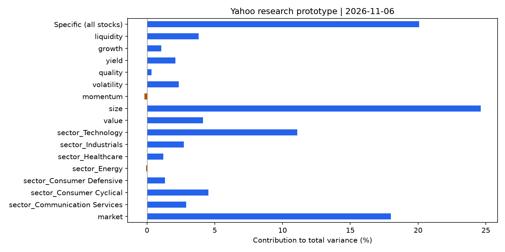
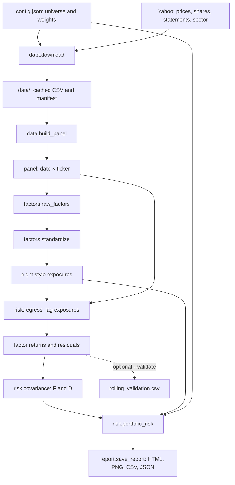

# Equity Factor Risk

An eight-style equity risk research project using Yahoo Finance. It estimates portfolio volatility, exposures and Euler risk contributions. This is an AI-assisted, MSCI-inspired educational prototype with approximate fundamental timing, not official MSCI/Barra output. It does not price derivatives or calculate VaR/ES.

**Reading order: data.py → factors.py → risk.py → main.py → report.py.** Detailed Chinese teaching notes and LaTeX formulas follow.



## Run

Open the folder in VS Code, using Python 3.11+:

```powershell
py -3.11 -m venv .venv
.\.venv\Scripts\python.exe -m pip install -r requirements.txt
.\.venv\Scripts\python.exe main.py --download
# Cached data:
.\.venv\Scripts\python.exe main.py
# Optional past-only calibration CSV; never shown in the HTML:
.\.venv\Scripts\python.exe main.py --validate
# Offline synthetic software check, NOT market results:
.\.venv\Scripts\python.exe main.py --synthetic --output outputs/synthetic
# Local tests; no GitHub Actions workflow is included:
.\.venv\Scripts\python.exe -m unittest discover -s tests -v
```

Open `outputs/report.html`. All functions below are the actual functions in this repository. No notebook, database or web server is required.

## 1. 设计思路：先定义问题，再分配文件职责

我们给定估值日和模拟持仓，计算：组合偏哪些风格／行业、模型年化波动多大、风险由哪些因素贡献。没有进行收益预测选股或组合优化。

| 符号 | 含义 | 维度 |
| --- | --- | --- |
| $N_t$ | 当天有效股票数，每天可以变化 | 单个数 |
| $K$ | 八风格 + 截距 + 行业对比项的列数 | 本次为 16 |
| $X_t$ | 完整模型暴露 | $N_t\times K$ |
| $f_t$ | 一天的因子收益 | $K\times1$ |
| $\varepsilon_t$ | 个股残差收益 | $N_t\times1$ |
| $F_t$ | 日频因子协方差 | $K\times K$ |
| $D_t$ | 特有方差的对角矩阵 | $N_t\times N_t$ |
| $w$ | 模拟持仓权重 | 持仓数 × 1 |

`exposures.csv` 只有八风格；`regress()` 中的 `design` 才有完整的 K 列。收益使用小数，1% 写作 0.01。

## 2. 为什么选这些股票？

`config.json` 中的 70 只股票是人工选择的、以熟悉的美国上市公司为主的演示样本。选择意图是美元计价、主要交易日历一致、行情和报表较容易获取，并覆盖不同业务。它不是经过收益回测挑选的股票池，不是历史 S&P 500 成分股，也没有证明是最优样本。

按本次 Yahoo 当前 sector 快照：

| Sector | 数量 | 股票代码 |
| --- | ---: | --- |
| Technology | 27 | AAPL, MSFT, NVDA, AVGO, ORCL, CRM, ADBE, AMD, QCOM, TXN, INTU, CSCO, IBM, ACN, NOW, AMAT, LRCX, KLAC, MU, ADI, INTC, PANW, CRWD, SNPS, CDNS, ANET, UBER |
| Communication Services | 8 | GOOGL, META, NFLX, DIS, CMCSA, T, VZ, TMUS |
| Consumer Cyclical | 9 | AMZN, TSLA, BKNG, ABNB, HD, LOW, NKE, SBUX, MCD |
| Consumer Defensive | 8 | WMT, COST, KO, PEP, PG, CL, MDLZ, HSY |
| Healthcare | 6 | JNJ, MRK, ABBV, AMGN, GILD, UNH |
| Industrials | 6 | CAT, DE, HON, GE, UPS, FDX |
| Energy | 5 | XOM, CVX, COP, EOG, SLB |
| Basic Materials | 1 | LIN |

科技明显偏多，材料只有一只，不能代表均衡市场；单一公司也无法可靠区分行业与个股变动。金融企业因资产负债结构及 ROE 可比性不同而未纳入；房地产、公用事业也没有覆盖。行业分类按供应商快照，不是手动认定，更不是历史分类。

OLS 中各股票权重相同，所以样本行业不平衡会影响结果。后续应扩充行业样本、使用当时可见股票池并检查稳健性，而不是声称当前样本已具代表性。

**建模股票池和持仓分开：** 70 只用于估计关系；报告只持有 AAPL、MSFT 各 15%，GOOGL、AMZN、WMT、KO、JNJ、CAT、XOM 各 10%。九股权重仅为跨行业演示，合计 100%，没有经过优化，不代表真实投资。

`SPY` 下载后生成 `market_return` 字段，但**当前回归没有使用它**。代码中的 `market` 是常数列的系数，不是 SPY 收益，也不是 CAPM Beta。

## 3. 数据 Input → Output



| 对象 | 形状 | 来源 → 去向 |
| --- | --- | --- |
| 原始缓存 | 每只股票的行情、股数、报表 | `download` → `build_panel` |
| `panel` | 行 `(date,ticker)`；列为行情、财务、行业 | `build_panel` → 因子计算和回归 |
| `raw` | 同一索引，八列原始指标 | `raw_factors` → `standardize` |
| `x` | 同一索引，八列标准化风格 | `standardize` → `regress` |
| `f` | 行日期，列全部模型因子 | `regress` → `covariance` |
| `eps` | 行日期，列股票 | `regress` → `covariance` |
| `F,D` | 因子协方差表、特有方差 Series | `covariance` → `portfolio_risk` |
| `summary, contributions, specific` | 摘要、逐因子表、逐股特有贡献 | `portfolio_risk` → `save_report` |

## 4. data.py：下载、清洗、历史对齐

### clean_dates(frame)

**Input:** 日期索引的 DataFrame。**Output:** 清理后的表。

删除时区信息，将时间归一到零点；同日重复保留最后一条，按日期排序。它只清理标签，不自动推断公告时刻或转换跨市场时区。

### download(config, directory="data")

**Input:** 股票列表、起止日期、benchmark。**Output:** 缓存文件和下载状态字典。

逐只调用 yfinance，保存 `prices.csv`（Close、Adj Close、成交量、分红、拆股）、`income.csv`（年利润表）、`balance.csv`（年资产负债表）、`shares.csv`（历史股数）、`metadata.json`（当前 sector）。benchmark 只下载行情。`manifest.json` 保存下载时刻、配置和逐股票成功／失败记录。

下载失败会记录，但不会自动清除旧缓存；重跑时须检查 manifest 和文件时间，不能假定所有输入同期刷新。benchmark 失败会停止。原始数据留在本地，不上传 GitHub。

### statement_row(frame, name)

**Input:** 报表、科目名。**Output:** 按财年排序的数字 Series。

读取并转换对应科目，列名变为日期；没有该科目返回空 Series，不填零。它为下一个函数提取收入、普通股净利润和普通股权益。

### annual_metrics(income, balance, lag)

**Input:** 两张年报、假设滞后天数。**Output:** `equity, income, roe, growth`，索引为 `available_proxy`。

设财年 y 的普通股净利润为 $NI_y$，普通股权益为 $B_y$，收入为 $Rev_y$：

$$
ROE_y=\frac{NI_y}{(B_y+B_{y-1})/2},\qquad
Growth_y=\frac{Rev_y}{Rev_{y-1}}-1.
$$

ROE 要求本期及上期权益为正；增长要求上期收入为正。两期报表间隔须为 300–430 天，避免把不同长度期间误作年度同比。

$$
available\_proxy_y=fiscal\_end_y+180\text{ calendar days}.
$$

这里把财年结束后 180 天当成代理可用日。**它不是真实公告日，也不能消除后续重述。** 输入是年度值，不是季度值或完整滚动 TTM。

### build_panel(config, directory="data")

**Input:** 缓存、配置。**Output:** `(panel, audit)`。

1. 读价格和 SPY 参照收益；
2. 按交易日期，向后匹配最近 `available_proxy`，不使用未来报表；距代理日期超过 550 天的值不用；
3. 历史股数只 forward-fill，不向首条记录以前 backfill；
4. 计算市值、收益、股息率和换手率；
5. 加入 sector，拼成 `(date,ticker)` panel；记录缺失、非正价格、极端收益和读取错误。

设 $A_{i,t}$ 为 Adj Close，$C_{i,t}$ 为 Yahoo Close，$Q_{i,t}$ 为历史股数，$J_{i,t}$ 为用于统一拆股基准的后续拆股倍率：

$$
Q^{adj}_{i,t}=Q_{i,t}J_{i,t},\qquad MC_{i,t}=C_{i,t}Q^{adj}_{i,t}.
$$

这是为了匹配 Yahoo 调整价格口径的市值代理，不是官方历史市值。拆股、成交量、股数、股息口径仍需独立核对。

$$
r_{i,t}=\frac{A_{i,t}}{A_{i,t-1}}-1,\qquad
Turnover_{i,t}=\frac{Volume_{i,t}}{Q^{adj}_{i,t}}.
$$

首个收益缺失正常。绝对日收益超过 40% 只标记，不自动删除。audit 的重复数在日期清理后计算，不能证明原始供应商数据没有重复。

## 5. factors.py：原始特征到标准化暴露

### raw_factors(panel)

**Input:** 标准 panel。**Output:** 八列 raw exposure。

逐只股票分组、排序，再做 rolling/shift，不混入其他股票数据。$t-21$ 和 $t-252$ 是该股票的观测行位移，近似交易日；代码不自动补齐缺失交易日。

| 因子 | 实际公式 | 高值含义 |
| --- | --- | --- |
| Value | $B_{i,y(t)}/MC_{i,t}$ | 相对账面权益便宜 |
| Size | $\ln MC_{i,t}$ | 公司大 |
| Momentum | $A_{i,t-21}/A_{i,t-252}-1$ | 过去涨得强，剔除最近约一月 |
| Volatility | $\sqrt{252}\,s(r_{i,t-59:t})$ | 历史波动大 |
| Quality | $NI_{i,y(t)}/[(B_{i,y(t)}+B_{i,y(t)-1})/2]$ | 年报 ROE 高 |
| Yield | $\sum_{u\in(t-365d,t]}Dividend_{i,u}/C_{i,t}$ | 现金股息率高 |
| Growth | $Rev_{i,y(t)}/Rev_{i,y(t)-1}-1$ | 年收入增长快 |
| Liquidity | $\frac1{60}\sum_{u=t-59}^{t}Turnover_{i,u}$ | 换手活跃 |

$y(t)$ 是代理可用日期不晚于 t 的财年。$s$ 是分母 n−1 的样本标准差。Volatility、Liquidity 要完整 60 个有效窗口；Value 要正权益和正市值，Liquidity 还要求当天换手为正。股息按 365 日历天滚动，样本起始不足一年时也可能有值，须留意覆盖期。

八组名称参考 [MSCI 风格框架](https://www.msci.com/research-and-insights/blog-post/creating-a-common-language-for-factor-investing)，公式由本项目选择，不是 MSCI 专有指标。与 Kani 十因子相比，不再单列 Beta、Earnings Yield、EPS Growth、Leverage，改用 ROE 和股息率等，形成八组。

### standardize(raw, minimum=35)

**Input:** raw 表。**Output:** 标准化八风格 `x`。

每天先保留八列都完整的股票，少于 35 只就跳过。每个因子按当日横截面 2.5% / 97.5% 分位数截尾：

$$
\widetilde{x}_{i,k,t}=\min\left(\max(x^{raw}_{i,k,t},q_{k,t}^{2.5\%}),q_{k,t}^{97.5\%}\right).
$$

再标准化：

$$
z_{i,k,t}=\frac{\widetilde{x}_{i,k,t}-\mu_{k,t}}{s_{k,t}},\quad
\mu_{k,t}=\frac1{N_t}\sum_i\widetilde{x}_{i,k,t},\quad
s_{k,t}=\sqrt{\frac1{N_t}\sum_i(\widetilde{x}_{i,k,t}-\mu_{k,t})^2}.
$$

这里使用总体标准差 `ddof=0`。例如三只股票 ROE 为 10%、20%、30%，不截尾时 Z-score 约为 −1.225、0、1.225，表示相对特征，不是收益。各因子分别按当天所有有效股票标准化，不沿单只股票历史标准化。

某列标准差接近零时跳过整日。完整案例筛选会使有效股票池变化，影响均值、暴露及回归。

当前没有做正交化或行业／规模中性化；行业用回归 dummy 控制，避免把 Size 对自身中性化后消掉。没有 IC 因子准入筛选：预测未来收益与解释风险是不同任务。

## 6. risk.py：回归、协方差与风险贡献

### regress(exposures, panel, minimum=35)

**Input:** 八风格暴露、股票收益 panel。**Output:** `(f, eps, ranks, design)`。

固定一天，用很多只股票做横截面 OLS。设计矩阵含：`market=1`、行业 dummy 对比列、八个风格。行业按字母排序，第一组为参照、不放 dummy；本次是 Basic Materials。

$$
r_{i,t}=a_t+\sum_{s\ne s_0}I_{i,s}g_{s,t}+\sum_{k=1}^{8}z_{i,k,t-1}f_{k,t}+\varepsilon_{i,t}.
$$

截距 $a_t$ 是参照行业、风格为零时的共同回归项；不是 SPY 实际收益。行业系数是相对参照行业的收益差。

**时间例子：** 11 月 5 日收盘算 $z_5$，用于解释 5 日收盘到 6 日收盘的 $r_6$。每股暴露滞后一条记录，核对来源为 panel 上一交易日；断档不用，不跨缺口沿用。这避免当日涨跌进入当日解释变量。

$$
\widehat f_t=\arg\min_f\|r_t-X_{t-1}f\|_2^2,\qquad
\widehat\varepsilon_t=r_t-X_{t-1}\widehat f_t.
$$

使用 `np.linalg.lstsq`，要求股票数至少 `max(minimum,K+5)`，并检查满列秩。不满秩日期记入 `ranks`，但不进入因子收益序列。没有默认市值加权。`f` 行为日期、列为 K 个模型项，`eps` 行为日期、列为股票。

### covariance(factor_returns, residuals, minimum=126)

**Input:** 选定历史窗口内的 `f, eps`。**Output:** 因子协方差 F、逐股特有方差 Series D、收缩强度。

普通样本因子协方差：

$$
S_{jk}=\frac1{T-1}\sum_t(f_{j,t}-\overline f_j)(f_{k,t}-\overline f_k).
$$

对角项是方差，非对角项是共同变化。实际调用 Ledoit–Wolf，将其内部经验协方差 $S_{ML}$ 向平均方差的单位矩阵收缩；其归一化约定与上面的无偏样本式不同：

$$
F=(1-\lambda)S_{ML}+\lambda\mu I,\qquad
\mu=\frac{\operatorname{tr}(S_{ML})}{K}.
$$

$\lambda$ 由算法估计。非对角项向零、各方差向平均方差拉近，以降低估计噪声，不意味着模型一定正确。[scikit-learn 官方说明](https://scikit-learn.org/stable/modules/generated/sklearn.covariance.LedoitWolf.html)

每股的特有风险来自历史残差的样本方差：

$$
d_i=\frac1{T_i-1}\sum_t(\varepsilon_{i,t}-\overline\varepsilon_i)^2,\qquad
D=\operatorname{diag}(d_1,\ldots,d_N).
$$

每股有效残差少于 126 天时保留缺失，不填零。代码返回 Series 而非真正分配 N×N 的 D。对角假设意味着残差互不相关；若遗漏行业等共同因素，残差未必真是独立公司风险。

### portfolio_risk(X, F, D, weights)

**Input:** 当前完整暴露、F、特有方差、权重。**Output:** `summary, table, specific_contribution`。

先按股票和因子名对齐；检查权重有限且合计为 1、持仓暴露与特有方差有效。当前配置为 long-only，但函数本身没有禁止负权重，也未实现融资／杠杆限制。

组合暴露：

$$
b=X^\top w.
$$

总协方差与组合日方差：

$$
\Sigma=XFX^\top+D,\qquad
v_p=w^\top\Sigma w=b^\top Fb+\sum_iw_i^2d_i.
$$

代码直接算右侧，避免分配大型股票协方差。年化波动：

$$
\sigma_{p,ann}=\sqrt{252v_p}.
$$

这不是最大亏损或预期收益；年化采用时间缩放近似。

Euler 因子方差贡献、逐股特有贡献及其加总：

$$
C_k=b_k(Fb)_k,\qquad C_i^{specific}=w_i^2d_i,\qquad
\sum_kC_k+\sum_iC_i^{specific}=v_p.
$$

输出的 `total_variance_share` 是 $C_k/v_p$，`annual_vol_contribution` 是：

$$
RC_{k,ann}=\frac{C_k}{\sqrt{v_p}}\sqrt{252}.
$$

$Fb$ 包含交叉协方差。只算 $b_k^2F_{kk}$ 会漏交叉项。贡献可以为负；大暴露不自动等于大贡献。贡献归属依赖行业参照和编码；Ledoit–Wolf 收缩也不对任意缩放／重参数化保持不变，因此改变模型编码可能改变总风险。

### rolling_validation(f, eps, design, panel, weights, window=252, minimum=126)

**Input:** 历史序列和固定模拟权重。**Output:** 逐日校准 CSV。只在 `--validate` 时调用，不进入 HTML。

每个 t 只用 t 之前最多 252 个有效回归日拟合 F/D，用滞后暴露估计当日方差，再与实际组合收益平方比较：

$$
r_{p,t}=\sum_iw_ir_{i,t},\qquad
CalibrationRatio=\frac{\sum_t r_{p,t}^2}{\sum_t\widehat v_{p,t}}.
$$

比值低于 1，表示这段比较里预测方差高于实际平方收益。平方收益噪声大，且包含均值平方，不能当成预测准确率。没有使用未来因子收益，但财报重述、行业快照和存续样本仍有偏差，所以不是严格 PIT 回测。缺失或不合格日期可能被跳过，不保证覆盖每个交易日。

## 7. main.py：统一运行入口

### synthetic_panel()

**Input:** 无。**Output:** 70 个虚构股票、750 个工作日的 panel。固定随机种子 17，生成共同随机收益和个股噪声：

$$
r_{i,t}=\beta_i m_t+u_{i,t},\qquad A_{i,t}=100\prod_{s\le t}(1+r_{i,s}).
$$

财务特征和行业也为测试构造。它检验函数能否连接，不是市场研究结果。

### run(config, output="outputs", data_dir="data", synthetic=False, validate=False)

1. 读真实缓存，或生成 synthetic panel；后者使用单独的十股等权测试持仓。
2. 保存数据审计、raw factor 覆盖率。
3. 计算 raw → standardized exposures。
4. 回归得到 f、eps、design 和秩检查。
5. 选择最新暴露日；若比 panel 最新日期落后超过 7 个日历日则停止。它不是相对电脑当天的绝对缓存新鲜度检查。
6. 用截至估值日最近最多 252 个有效因子日估计 F/D，要求至少 126 天。
7. 把用于历史回归的昨日风格替换为今日风格，构造当前风险暴露。
8. 算风险贡献；可选执行滚动 CSV。
9. 写中间文件、调用报告、打印摘要；返回 `summary` 字典。

文件末尾 `if __name__ == "__main__"` 才解析命令并运行；`import main` 不会自动下载。参数为 `--config`、`--data`、`--output`、`--download`、`--synthetic`、`--validate`。下载和 synthetic 不能同时指定。

## 8. report.py：排版结果，不重新计算风险

### save_report(output, summary, contributions, specific, audit, config, as_of, synthetic=False)

**Input:** 已算好的结果与配置。**Output:** HTML、PNG、CSV、JSON 文件，无金融返回值。

保存逐因子与逐股贡献、审计和摘要；贡献占比乘以 100 画横条图，负贡献用不同颜色；将图片 Base64 嵌入 HTML，因此无需服务器或外部图片链接。标记真实 Yahoo / synthetic、估值日和方法限制。

HTML 展示总风险、贡献表和数据审计，**不再展示 Validation**。数据有效性检查保留：删除报告区块不影响数学结果，但删除输入保护会让缺失风险被掩盖。

## 9. tests/test_model.py：可手动运行的本地测试

保留测试不增加运行主程序的步骤，也不需要 GitHub workflow。`ModelTests` 的每个方法：

| 测试方法 | 用途 |
| --- | --- |
| `test_euler_contributions_sum_to_direct_variance` | 打乱权重顺序，仍与直接矩阵方差一致，贡献加总为总方差 |
| `test_missing_specific_variance_is_rejected` | 缺少特有方差时拒绝计算，不当成零风险 |
| `test_statement_lag_and_annual_growth` | 核对年报代理日期、同比收入、平均权益 ROE |
| `test_standardization_and_lagged_regression` | 核对标准化、昨日暴露、协方差正定和特有方差非负 |
| `test_future_data_does_not_change_past_regressions` | 合成样本加入未来数据后，历史回归不变 |

最后一个只检验合成输入和算法，不证明 Yahoo 数据无重述。`unittest.main()` 仅启动测试，不参与报告。

## 10. 输出文件和可追溯样例

| 文件 | 内容 |
| --- | --- |
| `report.html` / `risk_contributions.png` | 报告和贡献图 |
| `summary.json` | 日期、配置、总风险 |
| `factor_contributions.csv` | 全模型因子暴露、方差贡献、总方差占比、年化波动贡献 |
| `specific_contributions.csv` | 逐持仓 $w_i^2d_i$ |
| `exposures.csv` | 八个标准化风格 |
| `factor_returns.csv` | 有效日的市场／行业／风格回归系数 |
| `factor_covariance.csv` / `specific_variance.csv` | 当前历史窗口 F/D |
| `factor_coverage.csv` | 每日各 raw 因子非缺失股票数 |
| `data_quality.csv` / `regression_quality.csv` | 读取／价格检查及每日样本数、矩阵秩 |
| `rolling_validation.csv` | 仅 `--validate` 写入；普通运行不会删除旧文件，核对生成日期 |

2026-11-06 样例：70 只下载成功，65 只有完整最新风格。ABBV、BKNG、LOW、MCD、SBUX 未进入最新完整横截面；具体原因须看各自源数据，不能自动将所有剔除归因于同一原因。

九股模拟组合、252 个有效因子日：模型年化波动率 **16.35%**，因子方差占 **79.92%**，特有方差占 **20.08%**。它们不是收益率或最大损失。

先前滚动诊断含 278 个有效日（2025-10-01 至 2026-11-06），平方收益／预测方差比值 **0.423**，显示这段样本中预测偏高。研究记录留在这里，HTML 为简洁而不显示；移除检验展示不等于修复模型。

## 11. 限制与归属

Yahoo 财报可能重述；180 天假设不等于真实披露日期；当前 sector、存续样本有历史偏差；样本偏科技、行业不平衡、完整案例筛选和窗口选择均影响风险估计。股数、拆股、股息、成交量和财务比率需要独立核对。此项目尚未达到机构风险模型验证标准。

数据使用需遵守供应商条款。GitHub 不上传原始行情、报表缓存或个人环境。GitHub Actions workflow 已删除；本地测试、输入保护和可选滚动研究函数保留。

Workflow inspired by [KaniGAO/AlphaStream](https://github.com/KaniGAO/AlphaStream). Elleny reports permission from the author to reuse the project. This version implements a new Yahoo layer, eight-style selection, lagged market/sector regressions, Euler contributions and optional past-only validation with AI-assisted development. This does not grant general reuse rights to third parties. Original contributors retain their attribution.
