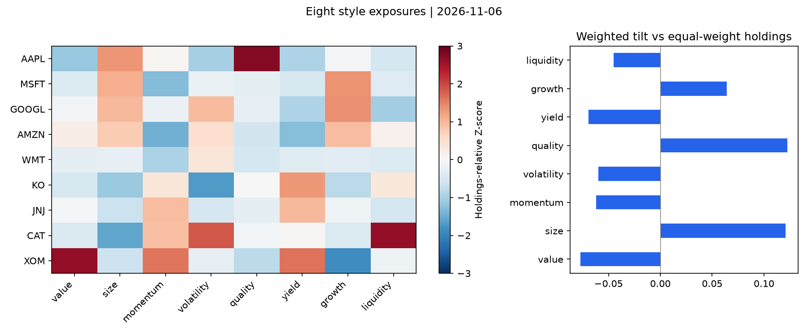
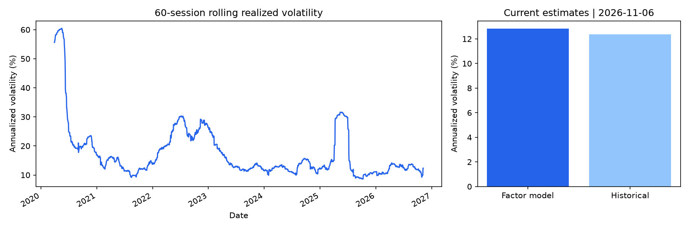
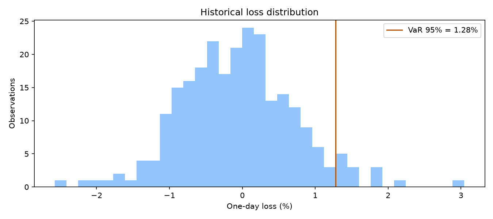
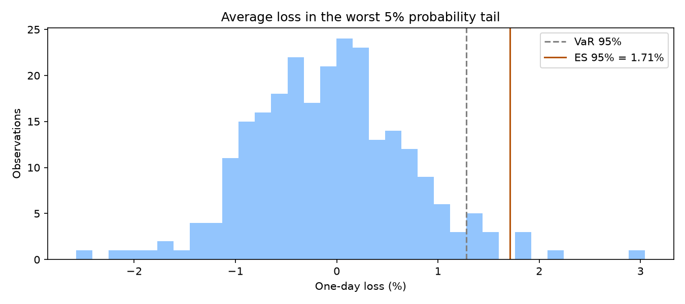
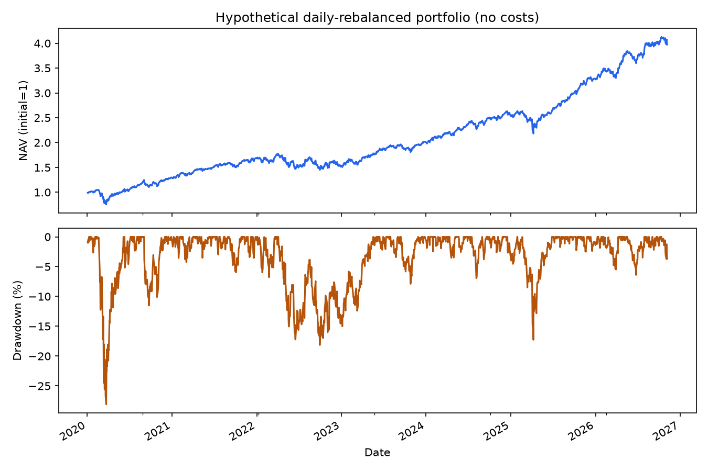

# Equity Portfolio Risk — RMSC4003 Extended Coursework

An independent extension of my **RMSC4003 coursework**, applying Python to a 20-stock hypothetical portfolio: eight style exposures, a cross-sectional factor risk model, historical volatility, 95% one-day VaR/ES, and simulated drawdown.

The factor selection follows **MSCI's eight style groups** — Value, Size, Momentum, Volatility, Quality, Yield, Growth and Liquidity — as described in [MSCI: Creating a Common Language for Factor Investing](https://www.msci.com/research-and-insights/blog-post/creating-a-common-language-for-factor-investing). The formulas below are transparent research proxies; this is not MSCI's proprietary Barra implementation.

## Architecture and AI use

| File | Responsibility / input → output | AI use |
| --- | --- | --- |
| `README.md` | Project description, methodology, formulas and example outputs | AI-assisted + Human-validated |
| `config.json` | The 20 holdings, weights, dates and calculation window | Holdings and weights: AI-recommended |
| `data.py` | Yahoo prices, shares and annual statements → cached data, aligned financial panel and portfolio returns | AI-assisted + Human-validated |
| `factor.py` | Aligned data → eight raw style characteristics | Hand-coded |
| `risk/factor_model.py` | Raw characteristics → daily standardized exposures, lagged cross-sectional regression and exposure chart | Hand-coded |
| `risk/volatility.py` | Factor returns/residuals → model volatility; held-stock returns → historical volatility | Hand-coded |
| `risk/var.py` | Recent portfolio returns → 95% historical VaR and loss-distribution chart | Hand-coded |
| `risk/expected_shortfall.py` | The same return sample → 95% historical ES and chart | Hand-coded |
| `risk/drawdown.py` | Portfolio returns → daily-rebalanced simulated NAV, current/max drawdown and chart | Hand-coded |

Portfolio: AAPL/MSFT each carry 10%, GOOGL/AMZN each 8%, and the other 16 stocks each 4%. The weights are illustrative, not optimized. 

## Formulas

### Data and eight raw factors

Let $A_{i,t}$ be adjusted price, $C_{i,t}$ Yahoo Close, $Q^{adj}_{i,t}$ historical shares put on a matching split basis, and $MC_{i,t}=C_{i,t}Q^{adj}_{i,t}$ the market-cap proxy. Let $B_y$, $NI_y$ and $Rev_y$ be common equity, common net income and revenue from the latest annual statement available under the timing assumption.

$$
r_{i,t}=\frac{A_{i,t}}{A_{i,t-1}}-1,\qquad r_{p,t}=\sum_iw_i r_{i,t}.
$$

| MSCI style group | Research proxy |
| --- | --- |
| Value | $B_y/MC_{i,t}$ |
| Size | $\ln MC_{i,t}$ |
| Momentum | $A_{i,t-21}/A_{i,t-252}-1$ |
| Volatility | $s(r_{i,t-59:t})\sqrt{252}$ |
| Quality | $NI_y/[(B_y+B_{y-1})/2]$ |
| Yield | $\sum_{u\in(t-365d,t]}Dividend_{i,u}/C_{i,t}$ |
| Growth | $Rev_y/Rev_{y-1}-1$ |
| Liquidity | $\frac1{60}\sum_{u=t-59}^{t}Volume_{i,u}/Q^{adj}_{i,u}$ |

Annual statements enter the panel at fiscal year-end + 180 calendar days, an assumed availability date rather than a verified filing date. They expire 550 days after that proxy date. Yahoo restatements and share/price/dividend adjustment conventions remain data limitations. Earnings and growth use annual statements, not a full rolling TTM calculation.

### Standardized exposures and weighted tilt

For each date and characteristic, standardize across the held stocks using population standard deviation:

$$
z_{i,k,t}=\frac{x_{i,k,t}-\overline{x}_{k,t}}{s_{k,t}},\qquad
s_{k,t}=\sqrt{\frac1N\sum_i(x_{i,k,t}-\overline{x}_{k,t})^2}.
$$

Only historical dates with complete eight-factor data for all 20 holdings enter the exposure panel. There is no extra winsorization, neutralization or orthogonalization.

The heatmap shows **stocks as rows, eight styles as columns, and Z-scores as colors**. Red means above this holdings sample's mean; blue means below it. Color indicates characteristic level, not positive/negative investment return or good/bad quality across every column.

$$
Exposure_k=\sum_iw_i z_{i,k},\qquad
Tilt_k=\sum_i\left(w_i-\frac1N\right)z_{i,k}=Exposure_k.
$$

The equality holds because cross-sectional Z-scores sum to zero. With 20 stocks, the equal-weight reference assigns 5% to each. The right-hand bar chart shows how the configured weights tilt the portfolio relative to that **same 20-stock equal-weight portfolio**, not relative to the broad market. An equal-weight portfolio would show zero tilt in all eight bars even though it still has substantial investment risk.

### Factor regression and model volatility

The previous trading session's eight exposures explain today's returns:

$$
r_{i,t}=a_t+\sum_{k=1}^{8}z_{i,k,t-1}f_{k,t}+\varepsilon_{i,t},\qquad
\widehat f_t=\arg\min_f\|r_t-X_{t-1}f\|_2^2.
$$

$X$ contains a constant and eight styles. The constant is called `market` in the code, but is a common regression intercept, not an observed index return. All 20 stocks form the sample; there are nine coefficients and, when full rank, eleven residual degrees of freedom.

For the latest 252 factor-return observations:

$$
F=Cov(f_t),\qquad d_i=Var(\varepsilon_{i,t}),\qquad D=diag(d_i),\qquad
\Sigma=XFX^\top+D.
$$

With current exposure $b=X^\top w$:

$$
\sigma_{model,ann}=\sqrt{252\left(b^\top Fb+\sum_iw_i^2d_i\right)}.
$$

This small-sample model assumes uncorrelated residuals and uses simple sample covariance/variance. There is no sector model or residual leverage correction. It is a research estimate, not an independently validated institutional risk forecast.

### Historical volatility

For the same configured historical return window:

$$
S_{ij}=\frac1{T-1}\sum_t(r_{i,t}-\overline r_i)(r_{j,t}-\overline r_j),\qquad
\sigma_{hist,ann}=\sqrt{252\,w^\top S w}.
$$

The chart also shows 60-session rolling realized volatility. Model and historical estimates have different methodologies and can differ.

### One-day historical VaR and ES: 95% only

Use the latest 252 complete daily portfolio returns and define losses $L_t=-r_{p,t}$. Sorted ascending losses are $L_{(1)},\ldots,L_{(n)}$:

$$
VaR_{0.95}=L_{(\lceil0.95n\rceil)}.
$$

For ES, sort losses descending, $L_{[1]}\ge\cdots\ge L_{[n]}$, and set $m=0.05n$, $q=\lfloor m\rfloor$, $a=m-q$:

$$
ES_{0.95}=\frac{\sum_{j=1}^{q}L_{[j]}+aL_{[q+1]}}{m}.
$$

This averages the worst 5% probability mass, including a fractional boundary observation when needed. Numbers are return fractions: 0.01 means 1%. Positive loss values mean losses; negative results are not clamped to zero. No normality assumption or multi-day square-root scaling is applied. These are not maximum-loss guarantees.

### Simulated NAV and drawdown

$$
NAV_t=\prod_{s\le t}(1+r_{p,s}),\qquad
H_t=\max(1,NAV_1,\ldots,NAV_t),\qquad
DD_t=\frac{NAV_t}{H_t}-1,\qquad MDD=\min_t DD_t.
$$

The initial NAV of 1 is included in the high-water mark. Using the same weights each day implies daily rebalancing, with no costs, taxes or slippage. This is a hypothetical path, not actual investment performance. Drawdown uses the full common return history; VaR/ES use the recent 252-session window.

## Outputs and examples

| Module | Chart | Numbers |
| --- | --- | --- |
| Factor exposures | `outputs/exposures.png` | Raw, stock-standardized and portfolio exposure CSVs |
| Volatility | `outputs/volatility.png` | `outputs/volatility.csv` |
| VaR | `outputs/var.png` | `outputs/var.csv` |
| ES | `outputs/es.png` | `outputs/es.csv` |
| Drawdown | `outputs/drawdown.png` | `outputs/drawdown.csv`, `outputs/drawdown_summary.csv` |

### Eight style exposures



### Model and historical volatility



### Historical VaR



### Historical ES



### Simulated NAV and drawdown



## Run locally

Python 3.11+, from the project root after installing `requirements.txt`:

```powershell
python -m risk.factor_model --download
python -m risk.volatility
python -m risk.var
python -m risk.expected_shortfall
python -m risk.drawdown
```

Run `python -m risk.factor_model` without `--download` to reuse the cache. Each command accepts `--config path.json`. Set the interpreter to the project's `.venv` in VS Code. Simplification removes custom fallback/error branches; inputs are assumed to match the configured 20-stock dataset. Ordinary Python/library errors propagate. Missing return rows are removed jointly across holdings, and incomplete factor dates are excluded. No additional data-quality report is generated.
